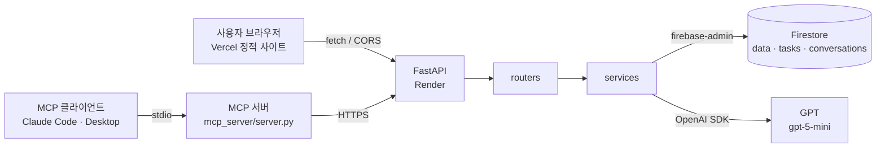
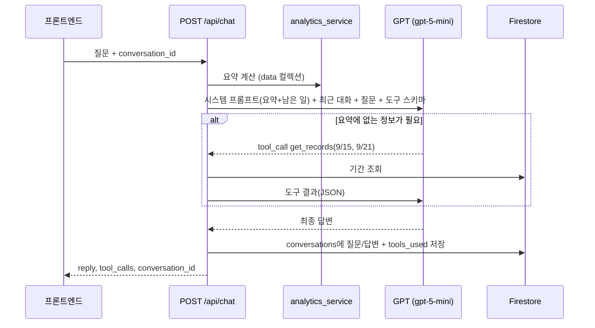
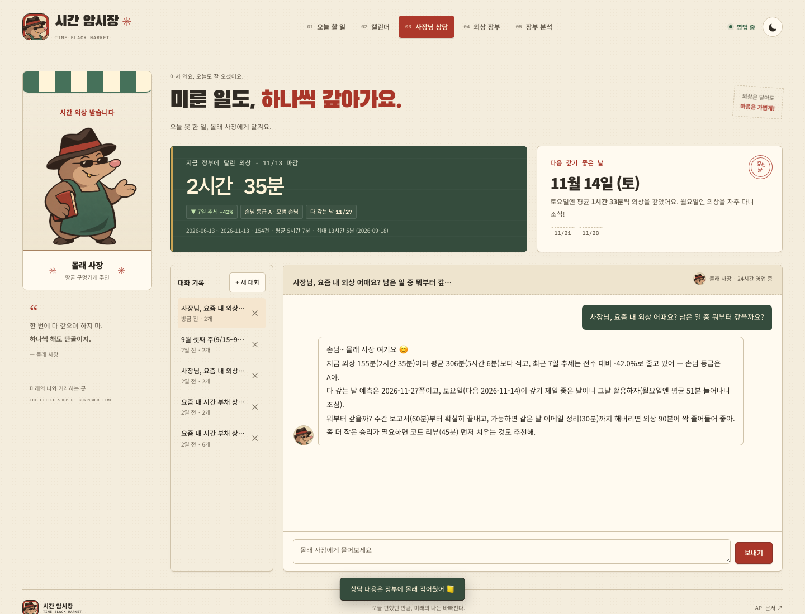
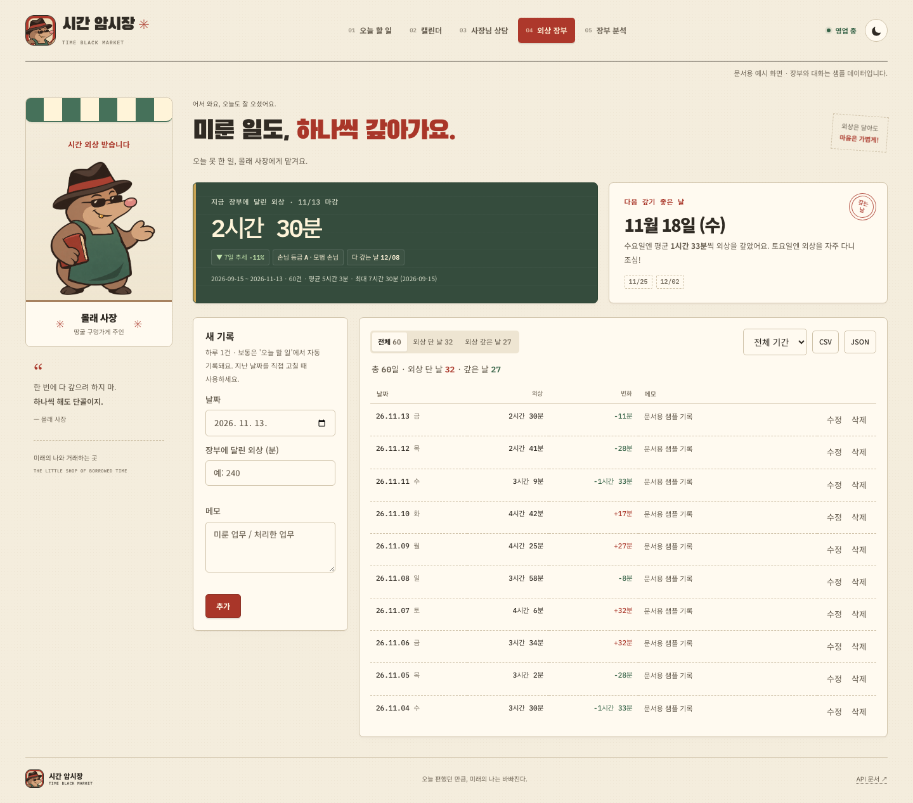
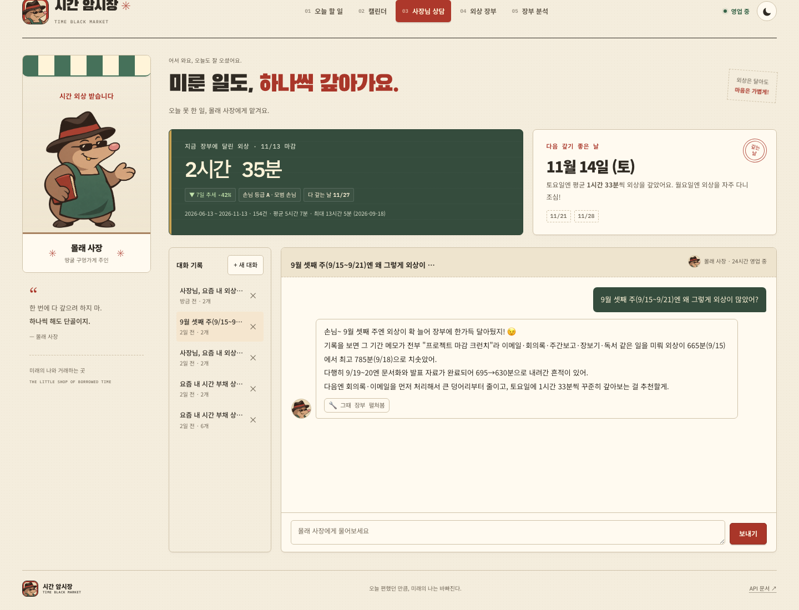

<p align="center">
  
</p>

<h1 align="center">시간 암시장 · Time Black Market</h1>

<p align="center">
  <b>오늘 편했던 만큼, 미래의 나는 바빠진다.</b><br />
  오늘 못 한 일을 미래의 시간에서 <b>외상</b>으로 당겨 쓰고, 땅굴 구멍가게 <b>몰래 사장</b>과 함께 갚아나가는 시간 외상 장부
</p>

<p align="center">
  <a href="https://time-black-market-frontend.vercel.app">서비스 바로가기</a> ·
  <a href="https://time-black-market-api.onrender.com/docs">Swagger</a> ·
  <a href="#로컬-실행-방법">로컬 실행</a>
</p>

---

## 서비스 소개

**무엇을 해결하나요?**
일반 ChatGPT는 내 데이터를 모릅니다. "이번 주 나 왜 이렇게 밀렸어?"라고 물어도 일반론만 돌아옵니다.
시간 암시장은 **내가 미룬 일의 시계열 기록**을 분석해서 요약을 만들고, 그 요약을 AI의 시스템 프롬프트에 주입해 **내 상황을 아는 AI 비서**로 답하게 합니다.

**어떻게 쓰나요?**

1. 오늘 할 일을 적으면 몰래 사장(AI)이 걸릴 시간을 **빠르게 / 보통 / 넉넉히**로 감정해 줍니다. 과거의 "예상 vs 실제" 기록을 반영해 점점 정확해집니다.
2. 고른 시간만큼 장부에 **외상**이 달립니다. 남은 일의 합계가 곧 **오늘의 시간 외상**이고, 하루 1건으로 자동 기록됩니다.
3. 끝낸 일은 체크하고 실제 걸린 시간을 적으면 외상을 **갚은** 것으로 지워집니다.
4. 쌓인 장부로 추세, **갚기 좋은 날**(요일), **다 갚는 날** 예측, **손님 등급**을 계산하고, 몰래 사장에게 상담할 수 있습니다.

| 용어 | 의미 |
|---|---|
| 외상 | 그날 마감 시점에 남아 있는 일의 예상 시간 합계(분). 시계열의 `value` |
| 외상 달기 / 갚기 | 전날보다 외상이 늘어난 날 / 줄어든 날 |
| 갚기 좋은 날 | 평균적으로 외상이 가장 많이 줄어드는 요일과 다가오는 날짜 |
| 다 갚는 날 | 최근 14일 순변화 속도가 유지될 때 외상이 0이 되는 예상일 |
| 손님 등급 | 지금 외상 ÷ 기간 평균 → A 모범 손님 · B 단골 손님 · C 외상 주의 · D 장부 빨간불 |

## 배포 URL

| 구분 | URL |
|---|---|
| 프론트엔드 (Vercel) | https://time-black-market-frontend.vercel.app |
| 백엔드 API (Render) | https://time-black-market-api.onrender.com |
| Swagger UI | https://time-black-market-api.onrender.com/docs |

> Render 무료 인스턴스는 한동안 요청이 없으면 잠듭니다. 첫 접속은 최대 1분 정도 걸릴 수 있으며, 프론트엔드가 `/health`로 서버를 깨우는 동안 "서버를 깨우는 중이에요 (N초)" 안내를 띄웁니다.

## 주요 기능

| 과제 요구사항 | 구현 |
|---|---|
| 데이터 기반 AI 채팅 | `POST /api/chat`: 요약 조회 → 시스템 프롬프트 주입 → GPT 호출(+도구) → 대화 자동 저장. 로딩 표시와 경과 시간 안내 |
| 데이터 관리 (CRUD) | 외상 장부 탭에서 `(date, value, memo)` 추가·수정·삭제. 하루 1건 규칙(중복 날짜 409). '오늘 할 일'로 오늘 기록을 자동 생성 |
| 대화 기록 저장·불러오기 | 사장님 상담 탭의 대화 목록 → 클릭하면 전체 메시지 다시 표시, 삭제 가능 |
| 데이터 요약 표시 | 상단 장부 카드(지금 외상·7일 추세·손님 등급·다 갚는 날·기간/개수)와 갚기 좋은 날 카드 |
| 배포·문서화 | Render(`render.yaml` Blueprint) + Vercel, Swagger, 이 README |
| 보너스 ① Function Calling + MCP | GPT 도구 6종, MCP 서버 도구 10종 ([아래](#보너스--ai-도구-호출-function-calling--mcp)) |
| 보너스 ② 인사이트·UX | `/api/data/statistics`, 외상 흐름 그래프·요일별 막대, 캘린더, CSV/JSON 내보내기, 다크 모드 |

## 기술 스택

| 영역 | 사용 기술 |
|---|---|
| Backend | Python 3.12, FastAPI, Pydantic v2, Uvicorn |
| Database | Firebase Firestore (firebase-admin) |
| AI | OpenAI Python SDK, `gpt-5-mini` (Chat Completions + Function Calling). 코디세이 공개 API(OpenAI 호환 게이트웨이)로 호출 |
| Frontend | HTML / CSS / Vanilla JavaScript(ES Modules), 의존성 없는 SVG 차트 |
| MCP | MCP Python SDK 2.x (stdio) |
| 배포 | Render (백엔드), Vercel (프론트엔드) |

## 아키텍처



**프로젝트 구조**

```
backend/
  main.py                 # 앱 생성, CORS, 예외 핸들러, 라우터 등록
  core/                   # config(.env·CORS·시간대), exceptions(공통 오류 응답), rate_limit
  models/                 # Pydantic 요청/응답 스키마 (data, task, conversation, chat)
  routers/                # HTTP 계층: 경로·상태코드·문서만 담당
  services/               # 비즈니스 로직
    data_service.py       #   data 컬렉션 CRUD (하루 1건 규칙)
    analytics_service.py  #   요약·통계 계산 (Firestore와 분리된 순수 함수)
    task_service.py       #   할 일 + 오늘의 외상 자동 계산(upsert)
    estimate_service.py   #   AI 예상 소요 시간
    chat_service.py       #   컨텍스트 주입 + Function Calling + 자동 저장
    tools.py              #   GPT 도구 스키마와 실행기
    conversation_service.py, firebase_service.py, llm.py
data/                     # 샘플 데이터 생성기, CSV, Firestore 업로드 스크립트
frontend/                 # index.html, styles.css, js/(app, tasks, charts, api), assets/
mcp_server/               # MCP 서버와 검증용 클라이언트
render.yaml               # Render Blueprint
```

**분리 기준:** 라우터는 "HTTP를 어떻게 받는가"만, 서비스는 "무엇을 하는가"만 담당합니다. 분석 로직(`analytics_service`)은 DB를 모르는 순수 함수라서, Firestore 없이 CSV만으로 테스트할 수 있고 요약 API·채팅·MCP가 같은 함수를 재사용합니다.

## 데이터와 분석

- **데이터:** 하루 1건, `value` = 그날 마감 시점 장부에 남은 외상(분). 샘플 150일(2026-06-13 ~ 11-09)을 [`data/generate_sample_data.py`](data/generate_sample_data.py)로 만들었습니다. 평일 외상 증가·토요일 상환·월말 보고 주간·9월 마감 크런치·최근 개선 추세 같은 패턴을 넣었습니다. 이후 기록은 '오늘 할 일'에서 자동으로 쌓입니다.
- **요약 (`GET /api/data/summary`)**: 기간·개수, 지금/평균/중앙값/최대/최소 외상, 누적 외상 단 시간·갚은 시간, 7일 추세(%), 갚기 좋은 날, 다 갚는 날, 손님 등급, 최근 7일 기록

<details>
<summary>요약 응답 예시</summary>

```json
{
  "period": { "start": "2026-06-13", "end": "2026-11-10", "days": 151 },
  "count": 151,
  "metrics": { "current": 155.0, "average": 309.5, "max": 785.0, "max_date": "2026-09-18", "min": 90.0 },
  "trend": { "label": "감소", "change_pct": -24.2, "description": "감소 (최근 7일 평균이 직전 7일 대비 -24.2%)" },
  "recommendation": {
    "weekday": "토", "next_dates": ["2026-11-14", "2026-11-21", "2026-11-28"],
    "reason": "토요일에 평균 1시간 33분씩 외상을 갚아서 갚기 제일 좋은 날. 월요일엔 평균 51분씩 외상이 늘어나니 조심"
  },
  "payoff_forecast": { "status": "갚는 중", "estimated_date": "2026-12-24", "days_left": 44 },
  "credit": { "grade": "A", "label": "모범 손님 — 평소보다 외상이 적음" }
}
```
</details>

**갚기 좋은 날을 '평균 외상'이 아니라 '평균 변화량'으로 고른 이유:** 외상 잔액은 전날 값에 끌려가서 요일 효과가 희석됩니다. "그 요일에 실제로 얼마나 줄였는가"가 갚을 여력을 더 직접적으로 보여줍니다.

## 컨텍스트 주입 원리

채팅 요청마다 **최신 요약을 계산해서 시스템 프롬프트에 문자열로 끼워 넣습니다.** 모델을 다시 학습시키지 않고도 GPT가 "내 데이터"를 근거로 답하게 하는 방식입니다.

```
당신은 'Time Black Market(시간 암시장)'의 외상 장부를 쥔 '몰래 사장'입니다. (캐릭터 말투 규칙 …)

[사용자 데이터 요약]
- 데이터 기간: 2026-06-13 ~ 2026-11-10 (151일)
- 총 레코드: 151개
- 주요 지표: 지금 외상 155분(2시간 35분), 평균 310분(5시간 10분), 최대 785분(13시간 5분) (2026-09-18) …
- 최근 트렌드: 감소 (최근 7일 평균이 직전 7일 대비 -24.2%)
- 갚기 좋은 날: 토요일 (다음 날짜 2026-11-14, 2026-11-21, 2026-11-28) — …
- 손님 등급: A (모범 손님 — 평소보다 외상이 적음)
- 최근 7일 기록: …

[현재 남은 업무 (할 일 목록)]
- 남은 업무 4개, 합계 2시간 35분 (= 오늘 달아둔 외상) …

위 데이터를 기반으로 맞춤형 답변을 제공하세요. 숫자는 요약이나 도구 결과에 있는 값만 사용 …
```

- 요약은 수십 줄로 압축한 정보라 토큰을 아끼고, 요약에 없는 세부 내용은 아래의 **도구**로 필요할 때만 가져옵니다.
- 이전 대화는 최근 10개 메시지만 함께 보냅니다.

## API

| Method | Path | 설명 |
|---|---|---|
| POST | `/api/data` | 데이터 추가 (하루 1건, 같은 날짜면 409) |
| GET | `/api/data` | 목록 (`?start=&end=` 기간 필터) |
| PUT | `/api/data/{id}` | 수정 (보낸 항목만) |
| DELETE | `/api/data/{id}` | 삭제 |
| GET | `/api/data/summary` | **요약 (프롬프트 주입용)** |
| GET | `/api/data/statistics` | 요일별·월별·7일 이동평균 |
| POST | `/api/conversations` | 대화 저장 |
| GET | `/api/conversations` | 대화 목록 (**messages 미포함**, 제목·개수·미리보기) |
| GET | `/api/conversations/{id}` | 특정 대화 전체 messages (불러오기) |
| DELETE | `/api/conversations/{id}` | 대화 삭제 |
| POST | `/api/chat` | AI 대화 (`conversation_id`로 이어서 대화) |
| POST | `/api/tasks/estimate` | AI 예상 소요 시간 |
| GET / POST / PUT / DELETE | `/api/tasks`, `/api/tasks/{id}` | 할 일 CRUD → 오늘의 외상 자동 재계산 |
| POST | `/api/tasks/{id}/complete`, `/reopen` | 완료(실제 시간 기록) / 되돌리기 |

**Firestore 컬렉션**

| 컬렉션 | 문서 필드 |
|---|---|
| `data` | `date`(YYYY-MM-DD, 하루 1건), `value`(분), `memo` |
| `conversations` | `title`, `messages[]`(`role`, `content`, `created_at`, `tools_used[]`), `created_at`, `updated_at` |
| `tasks` | `title`, `estimated_minutes`, `status`(open/done), `created_date`, `done_date`, `actual_minutes`, `ai_estimate` |

**입력 검증 (Pydantic):** 미래 날짜 거부, 외상 0~10080분, 메모 500자, 질문 1~1000자, 빈 수정 요청 400, 메시지 역할은 user/assistant만 허용. 오류는 400/404/409/422/429/503과 한국어 `detail`로 응답합니다.

## 로컬 실행 방법

```bash
# 1) 백엔드
python3.12 -m venv venv && source venv/bin/activate
pip install -r backend/requirements.txt
cp .env.example .env            # 값 채우기 (아래 환경 변수 참고)
uvicorn backend.main:app --reload   # http://127.0.0.1:8000/docs

# 2) 샘플 데이터 (선택)
python data/generate_sample_data.py     # data/sample_time_debt.csv 생성
python -m data.seed_firestore --overwrite
python -m data.seed_tasks               # 데모용 할 일

# 3) 프론트엔드 (새 터미널)
cd frontend && python3 -m http.server 5500   # http://localhost:5500
```

`frontend/config.js`의 기본 API 주소는 `http://127.0.0.1:8000`입니다.

## 환경 변수

**백엔드 (`.env` / Render)**

| 변수 | 필수 | 설명 |
|---|---|---|
| `OPENAI_API_KEY` | ✅ | GPT API 키 (코디세이 공개 API 키 또는 OpenAI 키) |
| `OPENAI_BASE_URL` | | OpenAI 호환 게이트웨이 주소. 코디세이: `https://copa.codyssey.kr/v1`, 비우면 OpenAI 공식 API |
| `OPENAI_MODEL` | | 기본 `gpt-5-mini` |
| `OPENAI_MAX_TOKENS` | | 답변 토큰 상한 (기본 2000, 추론 토큰 포함) |
| `FIREBASE_SERVICE_ACCOUNT_JSON` | ✅* | 서비스 계정 키 JSON 전체 (배포용) |
| `FIREBASE_SERVICE_ACCOUNT_PATH` | ✅* | 서비스 계정 키 파일 경로 (로컬용) |
| `ALLOWED_ORIGINS` | ✅ | CORS 허용 도메인, 쉼표 구분 |
| `ALLOWED_ORIGIN_REGEX` | | 정규식 허용 (Vercel 미리보기 주소 등) |
| `CHAT_RATE_LIMIT_PER_MINUTE` | | IP당 분당 AI 요청 수 (기본 10) |
| `APP_TIMEZONE` | | 기본 `Asia/Seoul` |

\* 둘 중 하나만 설정합니다.

**프론트엔드 (Vercel)**: `API_BASE_URL`. 빌드할 때 [`scripts/generate-config.mjs`](frontend/scripts/generate-config.mjs)가 `config.js`로 주입합니다. 바닐라 정적 사이트는 브라우저에서 환경 변수를 읽을 수 없기 때문입니다.

**MCP 서버**: `TBM_API_BASE_URL` (기본: 배포된 Render 주소)

## 배포

- **Render:** 대시보드 → New → **Blueprint** → 이 저장소를 고르면 [`render.yaml`](render.yaml)에 정의된 서비스가 생성됩니다. 비밀 값(`OPENAI_API_KEY`, `FIREBASE_SERVICE_ACCOUNT_JSON`, `ALLOWED_ORIGINS`)만 대시보드에서 입력합니다.
  - 빌드: `pip install -r backend/requirements.txt`
  - 실행: `uvicorn backend.main:app --host 0.0.0.0 --port $PORT`
  - 헬스 체크: `/health`
- **Vercel:** Root Directory를 `frontend`, Framework Preset을 Other로 두고 환경 변수 `API_BASE_URL`을 추가합니다. 빌드와 출력 설정은 [`frontend/vercel.json`](frontend/vercel.json)이 처리합니다.

## 보안·운영

- **키 관리:** API 키와 서비스 계정 키는 코드에 넣지 않고 환경 변수로만 다룹니다. `.env`와 키 파일은 `.gitignore`로 제외했습니다.
- **CORS:** `ALLOWED_ORIGINS`(+정규식)에 등록한 프론트 도메인만 허용합니다.
- **비용 제한:** 답변 토큰 상한, 질문 길이 제한, IP별 분당 요청 제한(429), 도구 호출 최대 3회, 이전 대화 10개만 전송
- **예외 처리:** 공통 핸들러가 Firestore 장애는 503, 예상하지 못한 오류는 500으로 감싸서 내부 정보를 노출하지 않습니다.
- **콜드스타트:** 프론트엔드가 `/health`로 서버를 깨우고, 진행 시간과 안내를 표시합니다.
- **한계:** 로그인 없는 1인용 서비스라서 URL을 아는 사람은 누구나 장부를 수정할 수 있습니다.

## 보너스 ① AI 도구 호출 (Function Calling + MCP)

### Function Calling: GPT가 쓰는 내부 도구

| 도구 | 언제 호출하나 (근거) |
|---|---|
| `get_records(start, end)` | 요약(최근 7일)에 없는 **특정 날짜·기간의 이유**를 물을 때 |
| `get_statistics(section)` | **요일·월 비교**가 필요할 때 |
| `list_tasks(status)` | 남은 일의 우선순위나 **예상 vs 실제** 시간을 물을 때 |
| `list_conversations` / `get_conversation(id)` | "지난번에 물어본 거" 같은 **이전 상담**을 언급할 때 |
| `get_data_summary` | 방금 데이터를 고쳤다고 해서 **최신 요약**이 필요할 때 |

요약은 항상 프롬프트에 들어가므로, 요약만으로 답할 수 있는 질문에서는 GPT가 **도구를 호출하지 않습니다.** 호출 결과는 응답의 `tool_calls`와 저장된 메시지의 `tools_used`에 남고, 화면에는 🔧 배지로 표시됩니다.

**실제 호출 기록 (배포 서버)**

| 질문 | 호출 | 판단 근거 |
|---|---|---|
| "요즘 내 외상 상황 어때? 갚기 좋은 날도 알려줘" | 없음 | 지금 외상, 추세, 갚기 좋은 날이 모두 요약에 있음 |
| "9월 셋째 주(9/15~9/21)에 왜 그렇게 많이 쌓였어?" | `get_records("2026-09-15", "2026-09-21")` | 요약에는 최근 7일만 있어서 해당 주의 메모(마감 크런치)를 조회 |
| "요일별로 비교하면 어떤 요일이 제일 위험해?" | 없음 | 갚기 좋은 날과 조심할 요일이 요약에 있음 |



### MCP 서버: 외부 채널 연동

[`mcp_server/server.py`](mcp_server/server.py)는 배포된 REST API를 감싸는 MCP 서버입니다. Firebase 키 없이 Claude Code나 Claude Desktop 같은 외부 AI 클라이언트에서 같은 기능을 도구로 호출합니다.

- **도구 10종:** `get_ledger_summary`, `get_statistics`, `get_records`, `list_tasks`, `list_conversations`, `get_conversation`, `estimate_task`, `ask_mollae`, `add_task`, `complete_task`
- **Claude Code:** 저장소의 [`.mcp.json`](.mcp.json)으로 자동 등록됩니다. 승인한 뒤 `/mcp`에서 연결을 확인합니다.
- **Claude Desktop:** `claude_desktop_config.json`에 추가합니다.

```json
{
  "mcpServers": {
    "time-black-market": {
      "command": "/절대경로/time-black-market/venv/bin/python",
      "args": ["/절대경로/time-black-market/mcp_server/server.py"]
    }
  }
}
```

**검증 (`python mcp_server/test_client.py --ask`)**

```
✅ 연결: time-black-market v1.0.0
🔧 도구 10개: get_ledger_summary, get_statistics, get_records, list_tasks, list_conversations, get_conversation, estimate_task, ask_mollae, add_task, complete_task
📒 get_ledger_summary → 지금 외상 155분, 등급 A, 갚기 좋은 날 2026-11-14
📅 get_records(9/15~9/21) → 7건, 최고 2026-09-18 785분 (독서 미룸 (프로젝트 마감 크런치))
📝 list_tasks → 남은 일 4개, 합계 155분
🕶️ ask_mollae → 손님~ 몰래 사장 왔지롱, 장부에 지금 외상 155분(2시간 35분) 찍어둘게요 🙂 …
```

**호출 흐름:** MCP 클라이언트(LLM) → 사용자 질문에 맞는 도구 선택(예: 기간 질문이면 `get_records`) → MCP 서버(stdio) → HTTPS로 Render API 호출 → Firestore/GPT → JSON 결과 → 클라이언트가 답변을 구성

## 보너스 ② 인사이트·UX

- **추가 지표:** `/api/data/statistics` (요일별 평균 외상·변화, 월별 평균·최대·최소·순변화, 7일 이동평균, 표준편차)와 요약의 갚기 좋은 날, 다 갚는 날, 손님 등급
- **시각화:** 외상 흐름 꺾은선(일별과 7일 평균, 30일/90일/전체, 툴팁), 요일별 외상 습관 양방향 막대, 월별 표, 증감을 색으로 보여주는 캘린더
- **내보내기:** 외상 장부 탭의 CSV(엑셀 한글 대응 BOM) / JSON. 현재 월·종류 필터를 그대로 반영
- **다크 모드:** 오른쪽 위 토글. 선택한 모드는 다음 방문 때도 유지
- **AI 예상 시간:** 할 일마다 빠르게/보통/넉넉히 3가지를 제안하고, 사용자의 과소/과대 추정 습관을 반영

## 스크린샷

| 데이터 요약이 보이는 채팅 | 데이터 관리 (CRUD) | 대화 기록 불러오기 |
|---|---|---|
|  |  |  |

## 디자인

두더지 **몰래 사장**의 땅굴 구멍가게 콘셉트로 로고, 캐릭터, 장부 UI를 구성했습니다.

- [디자인 보드](frontend/design.html): 로고·캐릭터·팔레트·UI 예시. 백엔드 없이 열 수 있습니다.
- [개발 인계 문서](docs/design/HANDOFF.md): 디자인 규칙, 적용 파일, 로컬 미리보기, 검증 범위
- [데스크톱 미리보기](docs/design/previews/shop-desktop.png) · [모바일 미리보기](docs/design/previews/shop-mobile.png)
